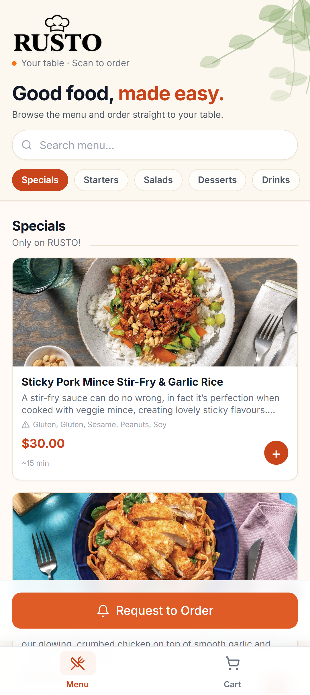
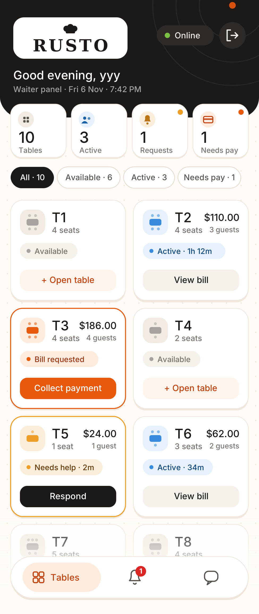
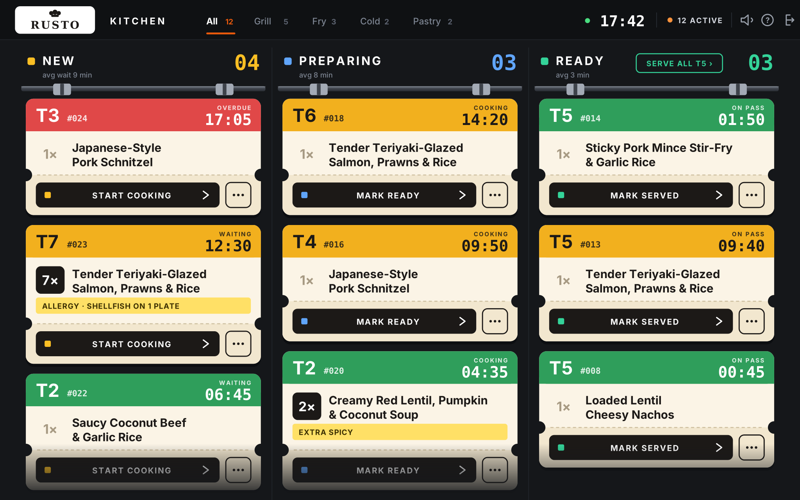
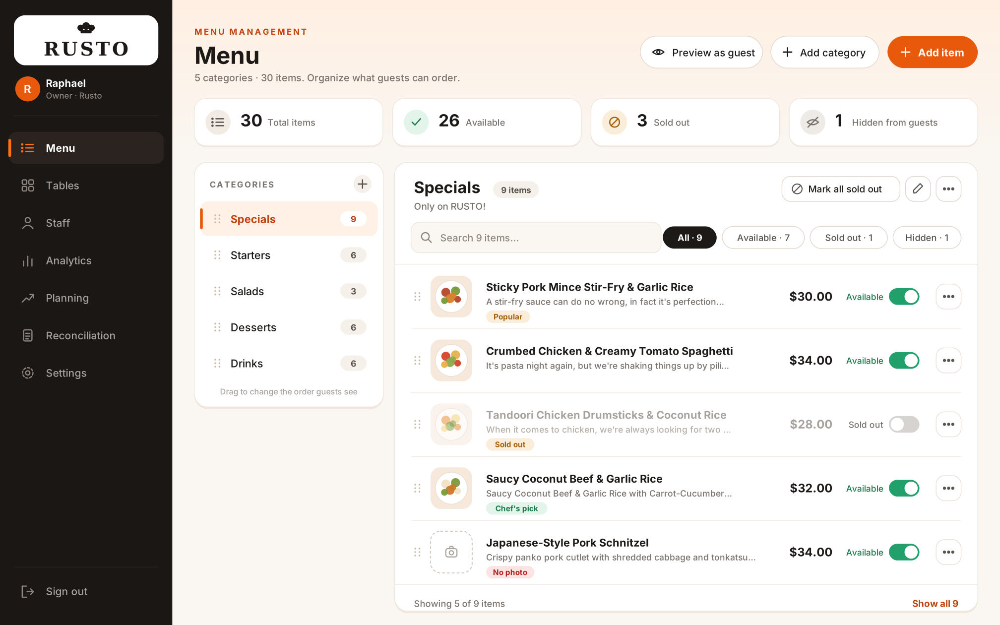

### 🍽️ [TableKey](https://github.com/tyrtu/TableKey) — *2026*

  

A full-stack QR-code restaurant ordering and management platform that connects customers, waiters, kitchen staff, and managers in one real-time workflow.

Customers can scan a table QR code, browse the menu without installing an app, request waiter approval, place orders, track their order status, and pay their bill. Restaurant staff receive role-specific workspaces for floor management, kitchen operations, billing, staff management, planning, and reporting.

- 📱 QR-based customer ordering with no app installation
- 🔐 Waiter-approved presence verification before ordering
- 🧾 Real-time order tracking from placement to serving
- 👨‍🍳 Kitchen display system with order status workflow
- 🧑‍🍳 Waiter floor view, request queue, help queue, and table management
- 📊 Manager dashboard for menus, staff, analytics, planning, and reconciliation
- 💳 Cash, Stripe, and M-Pesa payment integrations
- 🔒 Supabase Row Level Security and server-side billing RPCs
- ⚡ Realtime updates with polling fallback for shared PIN devices
- 📲 Shared-device authentication for waiters and kitchen staff

**Mobile Interfaces**

  

**Desktop Interfaces**

  

  

`React` `TypeScript` `Vite` `Tailwind CSS` `Zustand` `Supabase` `PostgreSQL` `Realtime`

---
