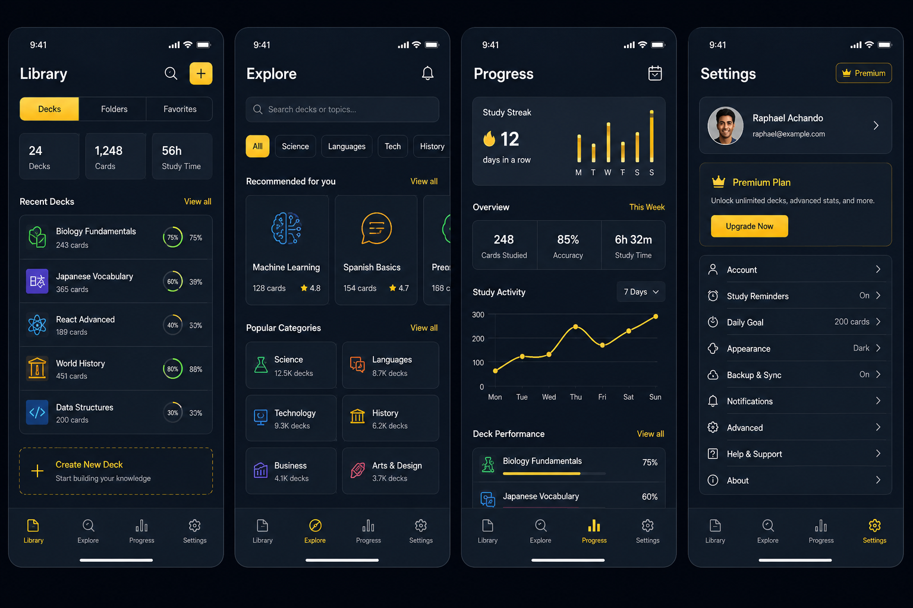
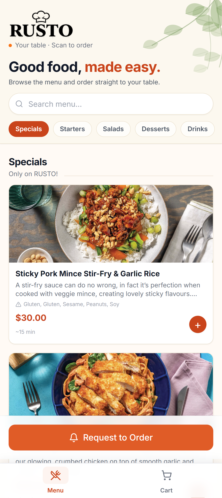
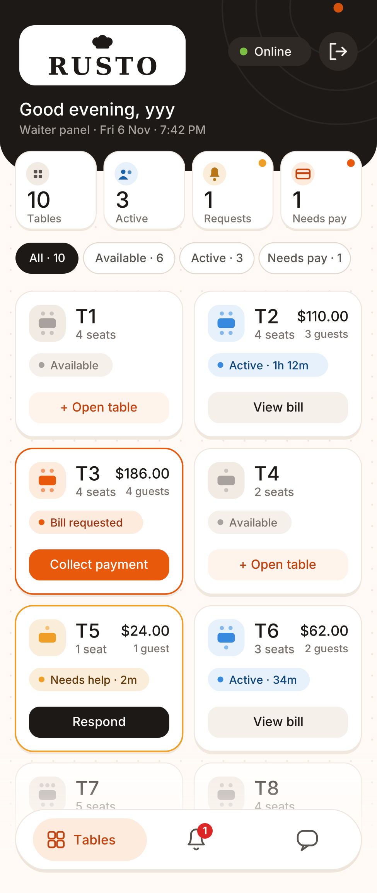
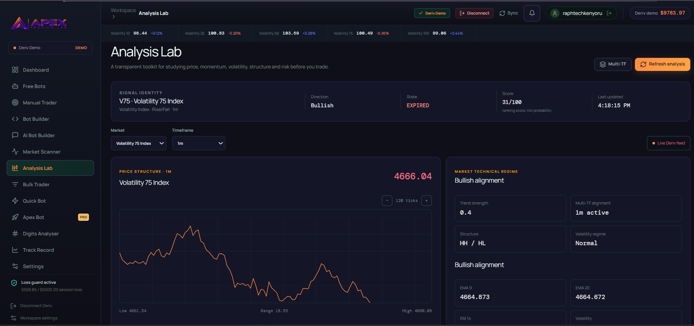
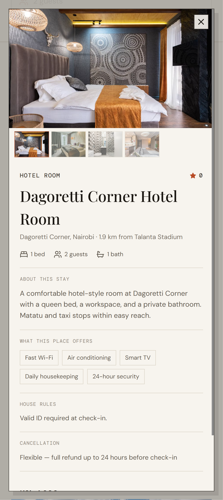
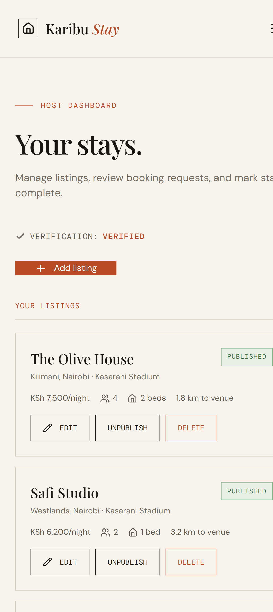
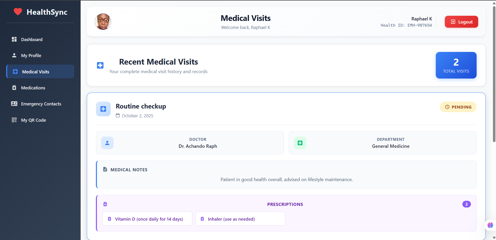
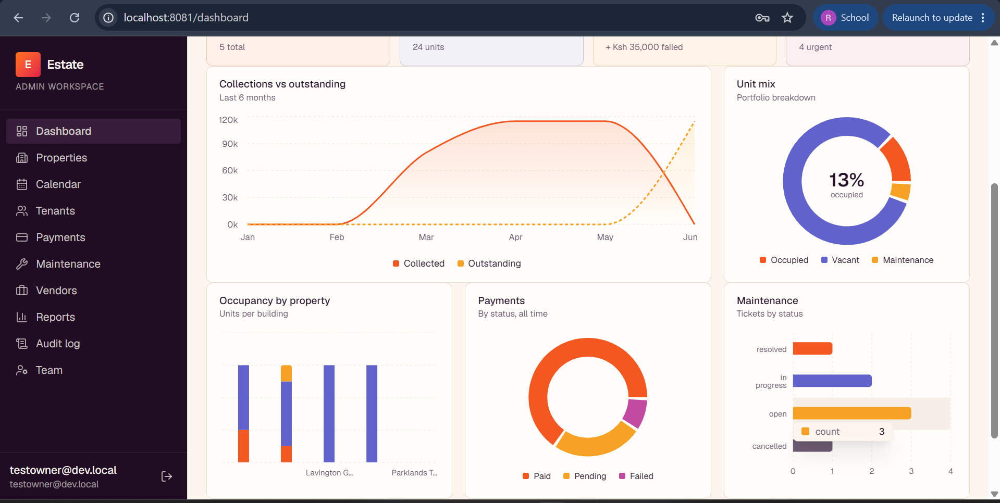

<div align="center">


<br/>


</div>

<br/>

## 👨‍💻 About Me

I'm a 4th-year **BSc Software Engineering** student at **Kisii University** (Expected 2027). I build full-stack products for the African market — multi-role platforms with real-time sync, Supabase RLS, Edge Functions, and M-Pesa and Stripe payment integrations. My focus is on systems that work correctly in real users' hands: a QR ordering platform used in restaurants, a short-term rental marketplace scoped to African football tournament venues, and an algorithmic trading terminal with live Deriv connections.

```
🌍 Location     : Kisii, Kenya
🎓 Education    : Kisii University — BSc Software Engineering
🔭 Currently    : Building Synapse, an AI-powered spaced repetition app
🌱 Learning     : Laravel, advanced backend architecture
💬 Ask me about : React, React Native, Supabase, M-Pesa integrations
⚡ Fun fact     : I'd rather ship something simple than something flashy and broken
```

> 🤝 Open to internships, freelance work, and collaboration — [raphaelkenyoru@gmail.com](mailto:raphaelkenyoru@gmail.com)

<br/>

## 🛠️ Tech Stack

<div align="center">

**Languages**

<br/>


**Frameworks & Libraries**

<br/>


**Databases, Backend & Payments**

<br/>


**Tools**

<br/>


**Also learning**

<br/>


</div>

<br/>

## 🚀 Featured Projects

---

### 🧠 Synapse — *In Progress*

[GitHub](https://github.com/tyrtu/Synapse)

<p align="center">

</p>

Most flashcard apps treat review as a chore. Synapse generates cards from your own notes with AI and schedules them using spaced repetition, so the material sticks without manual curation.

- AI-generated flashcards from user content
- Spaced repetition algorithm for optimal review timing
- Streak tracking and study analytics
- Polished onboarding and branding

`React Native` `Expo` `Appwrite` `NativeWind`

---

### 🍽️ TableKey — *2026*

[GitHub](https://github.com/tyrtu/TableKey) · [Live App](https://table-key.vercel.app/)

<p align="center">
  
  &nbsp;&nbsp;&nbsp;
  
</p>

Paper menus and verbal orders break down at scale and leave no audit trail. TableKey replaces the entire flow — customers scan a QR code at their table, place orders, and track status in real time, while waiters, kitchen staff, and managers each get a role-specific workspace. The hardest call was billing: rather than trusting the client, all payment calculations run as server-side Supabase RPCs under RLS so the bill can't be tampered with before it's settled.

- QR-based ordering with no app installation required
- Waiter-approval gate before a table can place orders
- Real-time order tracking from placement through to serving
- Kitchen display system with explicit status workflow
- Manager dashboard covering menus, staff, analytics, and reconciliation
- Cash, Stripe, and M-Pesa payment integrations
- Tamper-proof billing via server-side RPCs and Row Level Security

`React` `TypeScript` `Vite` `Tailwind CSS` `Zustand` `Supabase` `PostgreSQL` `Realtime`

---

### 📈 APEX Trading Lab — *2026*

[GitHub](https://github.com/suhark/APEX) · [Live App](https://apextradinglab.app/)

<p align="center">

</p>

Retail traders on Deriv lose sessions fast because there's no built-in circuit breaker. APEX adds a configurable session loss guardrail that stops all bots automatically when the threshold is hit, sitting on top of a full algorithmic execution terminal with live tick charts and multi-signal strategies.

- Manual terminal with tick charts and Rise/Fall contracts
- Algorithmic bots, Signal AI, and multi-signal strategies
- Session loss guardrail that halts all bots automatically
- Account context isolation and multi-step live trading arming

`React` `TypeScript` `Vite` `Supabase` `Deriv API`

---

### 🏡 Karibu Stay — *2026*

[GitHub](https://github.com/tyrtu/Karibu-Stay) · [Live App](https://karibu-stay-puce.vercel.app/)

<p align="center">
  
  &nbsp;&nbsp;&nbsp;
  
  &nbsp;&nbsp;&nbsp;
  
</p>

Africa On The Move 2027 will fill stadiums across the continent, but short-term accommodation near those venues is fragmented and hard to discover. Karibu Stay is a marketplace purpose-built for that context — guests filter by tournament venue and book directly, hosts list and manage properties. The key security decision was routing all booking writes through an Edge Function so RLS policies are enforced server-side and no client can bypass them.

- Interactive Mapbox map with price-label pins that fly to the selected venue
- Listings filterable by venue, price, property type, and guest count
- Favourites synced to account with local storage fallback before sign-in
- Booking flow with date validation and live price breakdown
- Post-stay guest reviews after host marks stay complete
- Host dashboard for listing creation, editing, publishing, and photo uploads
- All booking writes routed through a Supabase Edge Function under RLS

`React` `TypeScript` `Vite` `Tailwind CSS` `Mapbox GL JS` `Supabase` `PostgreSQL` `Edge Functions`

---

### ♟️ Skill-Based Chess Staking Platform — *2026*

[GitHub](https://github.com/tyrtu/stake-checkmate)

<p align="center">

</p>

Casual chess wagers between friends have no enforcement — someone always has to trust the other to pay up. This platform stakes funds before the match starts and pays the winner automatically by pulling the result from Lichess, removing the need for manual settlement.

- Pre-match staking with funds held until result is confirmed
- Live matches via Lichess API
- Automatic result tracking and winner payout

`React` `Node.js` `Supabase`

---

### 🩺 Emergency Digital Health ID System — *2025*

[GitHub](https://github.com/tyrtu/EMMERGENCY-DIGITAL-HEALTH-ID)

<p align="center">

</p>

In an emergency, responders need blood type, allergies, and conditions immediately — not after navigating a login screen. This system gives every patient a QR code that surfaces their critical information in seconds, while keeping edit access behind separate authentication flows for patients and clinical staff.

- QR code that surfaces critical patient data instantly
- Editable patient records
- Separate patient and staff authentication flows

`React` `Node.js` `MongoDB` `Tailwind CSS`

---

### 🏠 Rental Property Management System — *2024*

[GitHub](https://github.com/tyrtu/property-mgmt)

<p align="center">

</p>

Landlords managing multiple units by hand lose track of payment status and tenant history. This app centralises listings, tenant records, and rent payments in one place.

- Property and unit management
- Tenant tracking
- Rent payment records

`React` `Node.js` `Firebase`

---

<br/>

## 📊 GitHub Stats

<div align="center">

<picture>
  <source media="(prefers-color-scheme: dark)" srcset="https://github-readme-stats.vercel.app/api?username=tyrtu&show_icons=true&theme=tokyonight&hide_border=true&bg_color=15151C&title_color=7C3AED&icon_color=3FCF8E&text_color=F5F5F7"/>
  <source media="(prefers-color-scheme: light)" srcset="https://github-readme-stats.vercel.app/api?username=tyrtu&show_icons=true&theme=default&hide_border=true&title_color=7C3AED&icon_color=3FCF8E"/>
  
</picture>

<picture>
  <source media="(prefers-color-scheme: dark)" srcset="https://github-readme-stats.vercel.app/api/top-langs/?username=tyrtu&layout=compact&theme=tokyonight&hide_border=true&bg_color=15151C&title_color=7C3AED&text_color=F5F5F7"/>
  <source media="(prefers-color-scheme: light)" srcset="https://github-readme-stats.vercel.app/api/top-langs/?username=tyrtu&layout=compact&theme=default&hide_border=true&title_color=7C3AED"/>
  
</picture>

<picture>
  <source media="(prefers-color-scheme: dark)" srcset="https://github-readme-streak-stats.herokuapp.com/?user=tyrtu&theme=tokyonight&hide_border=true&background=15151C&ring=7C3AED&fire=3FCF8E&currStreakLabel=F5F5F7"/>
  <source media="(prefers-color-scheme: light)" srcset="https://github-readme-streak-stats.herokuapp.com/?user=tyrtu&theme=default&hide_border=true&ring=7C3AED&fire=3FCF8E"/>
  
</picture>

<picture>
  <source media="(prefers-color-scheme: dark)" srcset="https://github-readme-activity-graph.vercel.app/graph?username=tyrtu&theme=tokyo-night&hide_border=true&bg_color=15151C&color=7C3AED&line=3FCF8E&point=F5F5F7"/>
  <source media="(prefers-color-scheme: light)" srcset="https://github-readme-activity-graph.vercel.app/graph?username=tyrtu&theme=minimal&hide_border=true&color=7C3AED&line=3FCF8E"/>
  
</picture>

</div>

<br/>

## 🌐 Connect

<div align="center">

<a href="https://github.com/tyrtu"></a>
<a href="https://portfolio-sigma-one-qn0tpz6iie.vercel.app/"></a>
<a href="mailto:raphaelkenyoru@gmail.com"></a>

</div>


